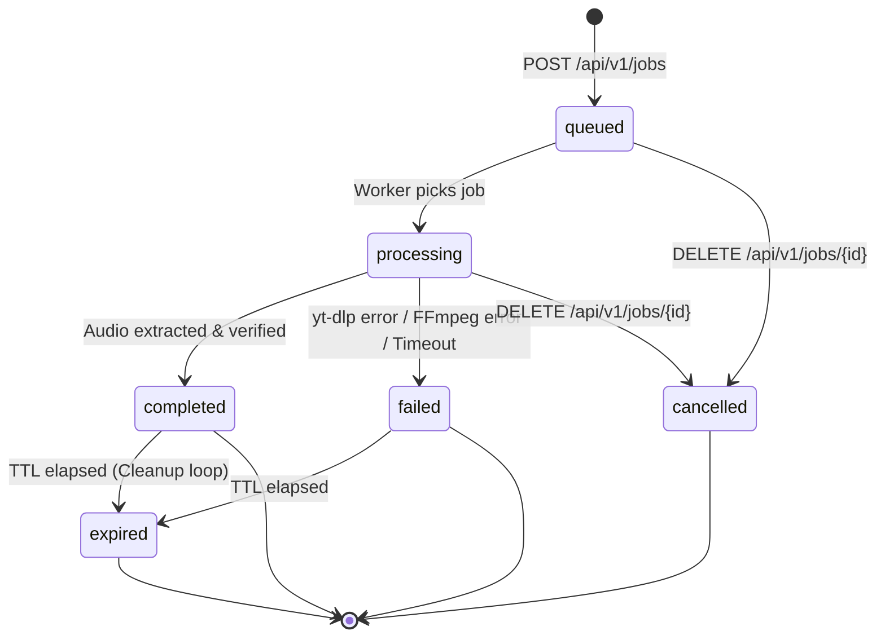

# Architecture & System Design

The **iOS Audio Downloader** is designed as a decoupled client-server architecture:
- **Client**: Native iOS Shortcuts automation (no native Swift app required).
- **Backend**: FastAPI web server with a bounded thread pool worker for media processing, aiosqlite for persistence, and static FFmpeg for audio transcoding.

---

## 1. High-Level Architecture Diagram

```mermaid
graph TB
    subgraph "iOS Client (iPhone)"
        A[Safari / YouTube / Instagram App] -->|Share Sheet| B[Apple Shortcut]
        B -->|Files App API| C[Local Storage: On My iPhone]
    end

    subgraph "Render Web Service (Linux VM)"
        D[HTTPS Ingress / Render CDN] -->|Reverse Proxy| E[FastAPI Application]
        
        subgraph "FastAPI Internal Services"
            E --> F[Auth & Rate Limit Dependency]
            E --> G[SSRF & URL Security Validator]
            E --> H[Job Service]
            H --> I[(SQLite with WAL Mode)]
            
            J[Worker Manager] -->|Bounded ThreadPool| K[yt-dlp Engine]
            K -->|Subprocess| L[FFmpeg / FFprobe Transcoder]
            J --> H
            J --> M[/Persistent Storage /var/data/]
        end
    end

    B -->|1. POST /api/v1/jobs| D
    B -->|2. Polling GET /api/v1/jobs/{id}| D
    B -->|3. GET /api/v1/jobs/{id}/file| D
    B -->|4. GET /api/v1/jobs/{id}/file?token=...| D
    D -->|Stream Audio Bytes| B
    B -->|Save Binary| C
```

---

## 2. Core Architectural Decisions

### A. Two-Phase Token-Based Binary Delivery
- **Problem**: iOS Shortcuts' `Get Contents of URL` handles Bearer Authorization headers reliably for JSON requests, but can strip custom headers or fail when streaming large binary files to disk.
- **Solution**:
  1. Client queries `GET /api/v1/jobs/{id}/file` with standard `Authorization: Bearer <TOKEN>`.
  2. Server responds with a short-lived (5 min), single-purpose HMAC-SHA256 signed URL: `/api/v1/jobs/{id}/file?token=<HMAC_TOKEN>`.
  3. Shortcut issues a plain `GET` to the tokenized URL to download the binary payload.
  4. Secret credentials are never exposed in logs or static paths, and the token expires quickly.

### B. Bounded ThreadPool Worker vs. Celery
- **Problem**: Traditional task queues (Celery, RQ) require external brokers like Redis or RabbitMQ, increasing infrastructure cost and deployment complexity on free/starter tiers.
- **Solution**: A native `ThreadPoolExecutor` wrapped by `WorkerManager`:
  - Python's `yt-dlp` and `ffmpeg` release the GIL during network I/O and process execution.
  - Bounded concurrency (`MAX_CONCURRENT_JOBS=2`) prevents server resource exhaustion.
  - Crash recovery is handled at application startup by marking stale `processing` jobs as `failed`.

### C. Write-Ahead Logging (WAL) SQLite
- High-concurrency async SQLite access via `aiosqlite`.
- SQLite operates in `WAL` mode (`PRAGMA journal_mode = WAL;`) allowing concurrent reads while write transactions are in progress.

### D. Comprehensive SSRF Defense
- Allowlist of media hosts (`youtube.com`, `youtu.be`, `instagram.com`).
- Mandatory HTTPS scheme.
- DNS resolution inspection using `socket.getaddrinfo` to prevent DNS rebinding.
- Strict blocklist of loopback, private, link-local, multicast, and AWS/GCP cloud metadata addresses (`169.254.169.254`).

---

## 3. Job State Machine


